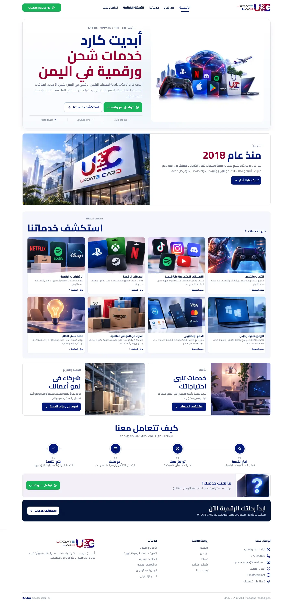

<div align="center">


# أبديت كارد | UPDATE CARD

موقع عربي لخدمات الشحن والبطاقات والاشتراكات والدفع والشراء الإلكتروني في اليمن، يعرّف العميل بالخدمات المتاحة ويوجّهه إلى طلبها عبر واتساب.

[زيارة الموقع](https://updatecard.net) · [الخدمات](https://updatecard.net/services/) · [التواصل](https://updatecard.net/contact/)

</div>

## فكرة المشروع

يجمع الموقع خدمات أبديت كارد للأفراد والجملة في واجهة سريعة ومتجاوبة. يتصفح العميل فئة الخدمة، يختار المنصة أو المنتج، ثم ينتقل إلى واتساب برسالة تتضمن سياق الطلب. يُؤكَّد التوفر والسعر والمنطقة أو الخطة المناسبة قبل التنفيذ.

الموقع تعريفي وتجاري؛ لا يحتوي لوحة إدارة أو حسابات مستخدمين أو قاعدة بيانات أو سلة شراء أو دفعًا داخل الموقع. المحتوى يُحدَّث من ملفات المشروع، وتتم متابعة الطلب خارج الموقع عبر واتساب.

## معاينة الموقع

**سطح المكتب**



**الهاتف**

<p align="center"></p>

## الخدمات والصفحات

- شحن الألعاب والتطبيقات الاجتماعية والترفيهية.
- البطاقات الرقمية والاشتراكات وتراخيص البرامج.
- الدفع الإلكتروني والشراء من المواقع العالمية والخدمات حسب الطلب.
- صفحات الرئيسية، من نحن، الخدمات وفئاتها الثماني، الأسئلة الشائعة، التواصل و404.

تُعرض الخدمات الفرعية داخل صفحة فئتها، ولكل خدمة رابط واتساب برسالة مخصصة. يجمع نموذج التواصل تفاصيل الطلب ويحوّلها إلى واتساب دون تخزينها على خادم.

## تجربة الاستخدام

- واجهة عربية RTL متجاوبة مع الهاتف والحاسوب.
- مقدمة شعار خفيفة للزيارة الأولى، مع حفظ حالة المشاهدة محليًا ودعم تقليل الحركة.
- صور AVIF/WebP محسّنة وخط Cairo مستضاف محليًا.
- بيانات مشاركة الروابط، وcanonical، وJSON-LD، وsitemap وrobots.
- النطاق الأساسي `https://updatecard.net` دون `www`؛ المسارات النهائية تنتهي بـ `/`، والروابط القديمة تُحوّل إليها.
- صفحات المحتوى قابلة للفهرسة، وصفحة 404 تحمل `noindex`؛ تجهيز SEO لا يضمن ترتيبًا أو فهرسة من Google.

## التقنية والبنية

الموقع مبني بـHTML وCSS وJavaScript ES Modules، دون إطار واجهات أو اعتماديات npm خارجية. يستخدم Node.js 24 لتوليد الصفحات؛ لا يحتاج إلى خادم تطبيقات وقت التشغيل.

| المسار | وظيفته |
|---|---|
| `src/config/site.js` | بيانات العلامة والنطاق والتواصل |
| `src/data/` | فئات الخدمات والكتالوج والأسئلة ورسائل الطلب |
| `src/pages/` | تكوين الصفحات |
| `src/components/` و`src/templates/` | العناصر المشتركة وقالب HTML وبيانات SEO |
| `src/client/` و`src/styles/` | التفاعلات والتنسيق والتجاوب |
| `src/assets/` | الصور والوسائط والخطوط المحلية |
| `brand/` | مصدر الشعار وأصول الهوية وأدوات توليدها |
| `scripts/build.mjs` | توليد ملفات الموقع داخل `dist/` |
| `scripts/dev.mjs` | بناء الموقع وتشغيل المعاينة المحلية |
| `vercel.json` | البناء والتوجيهات ورؤوس الاستجابة والتخزين المؤقت |

تُعدّل بيانات الخدمة في `src/data/`، وبيانات التواصل في `src/config/site.js`، ثم يعاد البناء. تُضاف المسارات وبيانات sitemap من `scripts/build.mjs`.

مصدر الشعار المعتمد صورة `brand/source/originals/update-card-logo-reference.jpeg`، ومشتقاته داخل `brand/`. الخطوط والألوان والأصول الحالية جزء من هوية الموقع. تُشغَّل أدوات Python الخاصة بالهوية يدويًا عند الحاجة، وتتطلب Pillow؛ ليست جزءًا من بناء الموقع. ترخيص خط Cairo محفوظ مع ملفاته.

## التشغيل والنشر

المتطلبات: **Node.js 24.x** وnpm. لا يلزم `npm install` لأن المشروع لا يعرّف اعتماديات خارجية.

```bash
npm run dev
```

المعاينة: `http://localhost:4173`. بعد تعديل ملفات المصدر أعد تشغيل المعاينة لإعادة البناء.

لبناء نسخة النشر:

```bash
npm run build
```

يولّد البناء **14 صفحة HTML** مع CSS وJavaScript والأصول وملفات الفهرسة داخل `dist/`. هذا المجلد مولّد ولا يُحفظ في Git. النشر على **Vercel** من `main`، بأمر `npm run build` ومجلد إخراج `dist`، وعلى النطاق [updatecard.net](https://updatecard.net).

## المطور

**م. إلياس الشعيبي — Elyas Al Shaebi**

تصميم الهوية الرقمية، تطوير الواجهة والموقع، تحسين الأداء وSEO، وإعداد البناء والنشر.

[GitHub](https://github.com/7eaur) · [وصل تك](https://www.wasl-tech.com)
