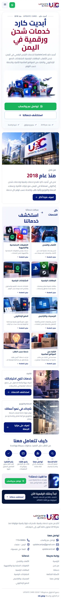

<div align="center">


# أبديت كارد | UPDATE CARD
### خدماتك الرقمية في مكان واحد

**موقع عربي لخدمات الشحن والبطاقات الرقمية والاشتراكات والدفع والشراء الإلكتروني في اليمن، يسهّل استعراض الخدمات وطلبها مباشرة عبر واتساب.**

[](https://developer.mozilla.org/en-US/docs/Web/HTML)
[](https://developer.mozilla.org/en-US/docs/Web/CSS)
[](https://developer.mozilla.org/en-US/docs/Web/JavaScript)
[](https://nodejs.org/)
[](https://vercel.com/)

**[🌐 زيارة الموقع](https://updatecard.net)**

</div>

---

## 📱 Screenshots | صور الموقع

<div align="center">

**سطح المكتب**


**الهاتف**



</div>

---

## ✨ Key Features | المميزات الرئيسية

- 🎮 **خدمات رقمية متنوعة:** شحن الألعاب والتطبيقات والبطاقات الرقمية والاشتراكات وتراخيص البرامج.
- 🛒 **الدفع والشراء الإلكتروني:** عرض خدمات الدفع والشراء من المتاجر والمواقع العالمية.
- 💬 **الطلب عبر واتساب:** روابط طلب مخصصة تنقل تفاصيل الخدمة المطلوبة إلى المحادثة.
- 🗂️ **كتالوج منظم:** تصنيف الخدمات إلى فئات مع صفحات واضحة للتصفح والاستكشاف.
- 📱 **تصميم متجاوب:** واجهة عربية RTL مناسبة للهاتف والحاسوب.
- ⚡ **أداء محسّن:** صور WebP وAVIF وخطوط محلية وصفحات ثابتة سريعة.
- 🔎 **تهيئة لمحركات البحث:** بيانات وصفية، وروابط مشاركة، وملفات sitemap وrobots وبيانات منظمة.

---

## 🛠️ Tech Stack | التقنيات

| الجانب | التقنيات |
|---|---|
| **Frontend** | HTML5, CSS3, JavaScript (ES Modules) |
| **Build** | Node.js 24 |
| **Architecture** | Static Website, Reusable Components & Templates |
| **SEO** | Metadata, JSON-LD, Sitemap |
| **Deployment** | Vercel |

---

## 📂 Project Structure | هيكل المشروع

```text
update_card/
├── src/
│   ├── config/          # إعدادات الموقع والتواصل
│   ├── data/            # بيانات الخدمات والكتالوج
│   ├── pages/           # صفحات الموقع
│   ├── components/      # المكونات المشتركة
│   ├── templates/       # قوالب الصفحات
│   ├── client/          # تفاعلات الواجهة
│   ├── styles/          # التنسيقات والتجاوب
│   └── assets/          # الصور والخطوط
├── brand/               # أصول الهوية والشعار
├── docs/screenshots/    # صور الواجهات
├── scripts/             # أدوات البناء والمعاينة
├── package.json
└── vercel.json
```

---

## 🚀 Getting Started | التشغيل المحلي

**المتطلبات:** Node.js 24.x وnpm.

1. استنساخ المستودع:

   ```bash
   git clone https://github.com/7eaur/update_card.git
   cd update_card
   ```

2. تشغيل المعاينة المحلية:

   ```bash
   npm run dev
   ```

   افتح `http://localhost:4173`. أعد تشغيل الأمر بعد تعديل المصدر لإعادة البناء.

3. إنشاء ملفات النشر:

   ```bash
   npm run build
   ```

تُنشأ ملفات الموقع الثابتة داخل `dist/`، وتُنشر النسخة على [updatecard.net](https://updatecard.net).

---

## 👨‍💻 Developer | المطور

**Eng. Elyas Al Shaebi — المهندس إلياس الشعيبي**

📱 **Phone / WhatsApp:** [+967 775 377 979](https://wa.me/967775377979)

[GitHub](https://github.com/7eaur)
